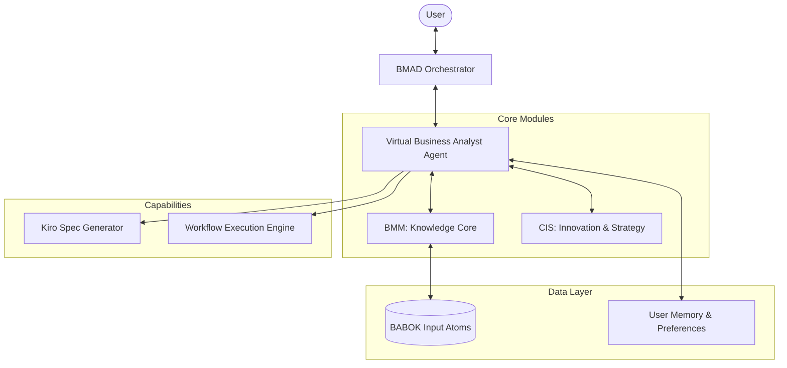

# Design: Virtual Business Analyst (VBA)

The VBA is a multi-agent system built on the BMAD Method and CIS module. It leverages a modular architecture to provide scalable and specialized business analysis capabilities.

## System Architecture

## Component Design

### 1. BMAD Orchestrator
- **Role**: Manages the interaction between the user and the agent ecosystem.
- **Workflow**: Routes requests to the VBA agent and handles "party/team mode" synchronization.

### 2. VBA Agent (`ba.md`)
- **Role**: The primary domain expert for Business Analysis.
- **Expertise**: BABOK v3 Guide, Requirement Engineering, Stakeholder Management.
- **Tools**: `analyze_atom`, `generate_ears`, `swot_analysis`.

### 3. CIS Module Integration
- **Innovation Strategist**: Assists the VBA in identifying disruptive opportunities during strategic analysis.
- **Storyteller**: Enhances requirement documentation by crafting compelling narratives for stakeholders.

### 4. BABOK Input Atoms
- Pre-processed text and images from the BABOK Guide, indexed for fast retrieval by the VBA.

## Interaction Flow: Requirement Analysis

1.  **User** submits a raw requirement.
2.  **VBA Agent** receives the requirement and searches **BABOK Atoms** for relevant context (e.g., Knowledge Area 5: Requirements Analysis and Design Definition).
3.  **VBA Agent** uses the **Kiro Spec Methodology skill** to transform the raw text into **EARS notation**.
4.  **CIS Storyteller** reviews the requirements to ensure they resonate with the target stakeholder personas.
5.  **VBA Agent** returns the refined requirements and a **Stakeholder Impact Analysis**.

## Error Handling & Validation
- **Requirement Conflict**: VBA SHALL notify the user if a new requirement contradicts an existing one in the Memory layer.
- **Unclear Context**: VBA SHALL prompt for clarification if the input atom matching confidence is below 70%.
