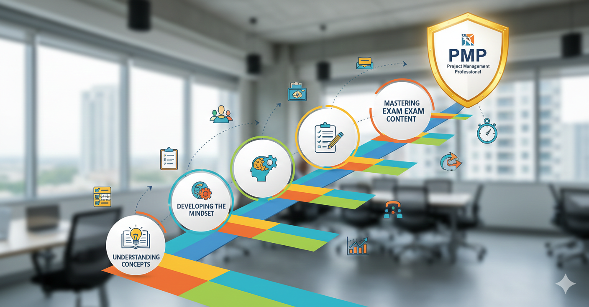
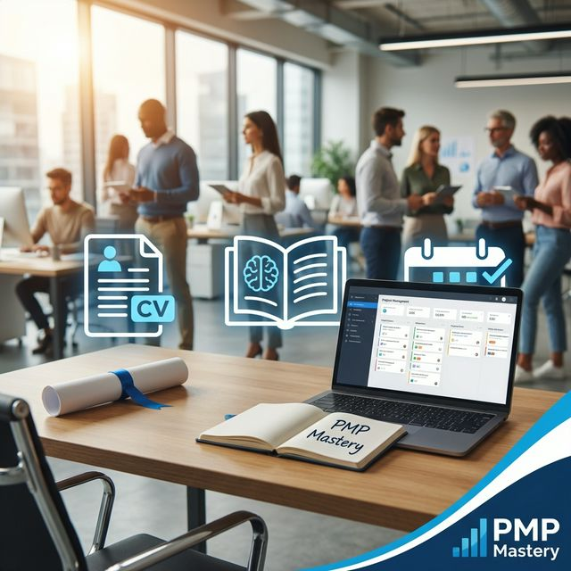
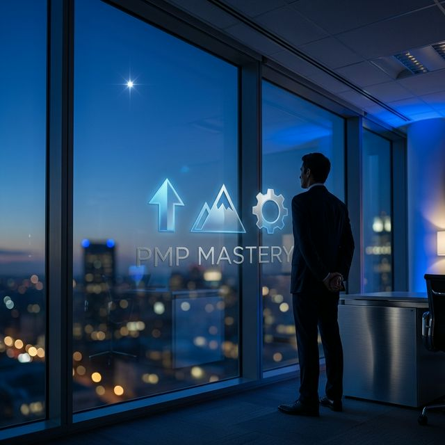

<!-- _class: cover -->

PMP exam preparation course

  PMP
  
  Mastery Framework

Day 1 session

<h1 class="cover-title">Introduction &amp; Foundations</h1>

---

<!-- _class: agenda -->
# What We Cover Today
## Your Day-1 outcomes

- **Exam blueprint**: what PMI actually tests (ECO)
- **Domain weightings**: where your study time should go
- **Exam mechanics**: 180 questions, timing, breaks, question types
- **Resource stack**: ECO, PMBOK Guide, Agile Practice Guide
- **PMP mindset**: how top answers are selected
- **Your plan**: 13-week path and immediate next actions

---

<!-- _class: calendar-embed -->

---

# ECO-First Course Focus

- The **PMP Exam Content Outline (ECO)** is the exam blueprint.
- PMBOK Guide and Agile Practice Guide are supporting references.
- We train on **Domains, Tasks, and Enablers** exactly as tested.

### Domain Weighting
- **People**: 42% (about 76 questions)
- **Process**: 50% (about 90 questions)
- **Business Environment**: 8% (about 14 questions)

---

# Exam Format & Logistics

- **180 questions** total (scored + unscored pretest)
- **230 minutes** total testing time
- **2 optional breaks** (after Q60 and Q120)
- Approx. **1.3 minutes per question** pace
- Computer-based testing with on-screen tools

**Implication:** time control and decision discipline matter as much as content.

---

# Question Types You Will Face

1. **Multiple choice** (most common)
2. **Multiple response**
3. **Matching**
4. **Hotspot**
5. **Fill-in-the-blank**

### Response Strategy
- Read the scenario first, then the ask.
- Eliminate options that violate PMP mindset.
- Choose the **best next action**, not just a technically true action.

---

# Essential Study Resources

- **ECO**: your source of truth for what is tested
- **PMBOK Guide (7th)**: principles, performance domains, methods
- **Agile Practice Guide**: agile and hybrid delivery logic
- **Course assets**: question bank, mock exams, templates, forum

**Priority order:** ECO -> question practice -> concept reinforcement.

---

# The PMP Mindset (Core)

- **Proactive**: prevent issues before escalation
- **Value-driven**: optimize outcomes, not activity volume
- **Stakeholder-centric**: engage early, align continuously
- **Servant leadership**: support team performance and ownership
- **Ethical**: responsibility, respect, fairness, honesty

This mindset is the filter for situational questions.

---

# 13-week plan snapshot

- **87 total lessons** mapped to ECO priorities and weekly reviews
- **7-10 hours/week** rhythm: M-F short sessions + Saturday review
- **3-phase progression**: Foundation -> Execution -> Mastery
- **Exam-week finish** with logistics, exam day, and post-exam reflection

Consistency beats cramming. Complete each week before advancing.

---

# Study Allocation Guidance

Match your study time to exam weighting:

- **50% Process**
- **42% People**
- **8% Business Environment**

If you study 12 hours/week:
- Process: ~6h
- People: ~5h
- Business Environment: ~1h

---

<!-- _class: tips calendar-snap -->

# How to use this study system
## Keep momentum without overload

- Follow the week sequence; do not skip review days.
- Use Sunday for light review and reset planning.
- Track your weakest domain every week and rebalance hours.
- Convert missed days into scheduled catch-up blocks next week.

---

<!-- _class: tips -->
# Day-1 Action Checklist
## Complete these before Day 2

- Download the latest official **PMP ECO** from PMI.
- Confirm your baseline study schedule for this week.
- Set your target exam window.
- Capture your top 3 motivations for certification.
- Identify one weak domain to prioritize early.

---

# Q&A + Next Session

- Open questions on structure, scope, and expectations
- Clarify any confusion on ECO vs PMBOK usage

### Tomorrow (Day 2)
- Resource deep dive
- How to use ECO, PMBOK, and Agile Guide together
- Setup of your repeatable daily study workflow
- Download the 13-week study calendar and mark your exam window today.
