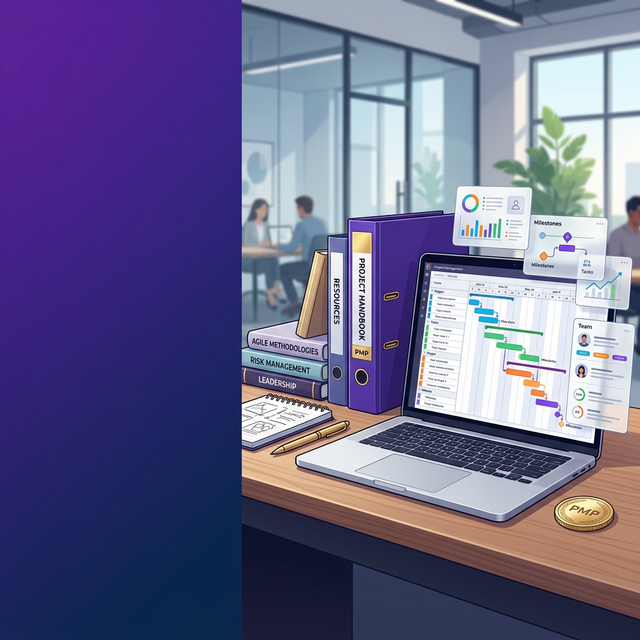
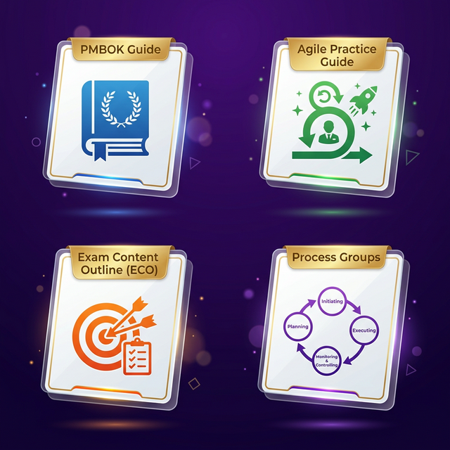
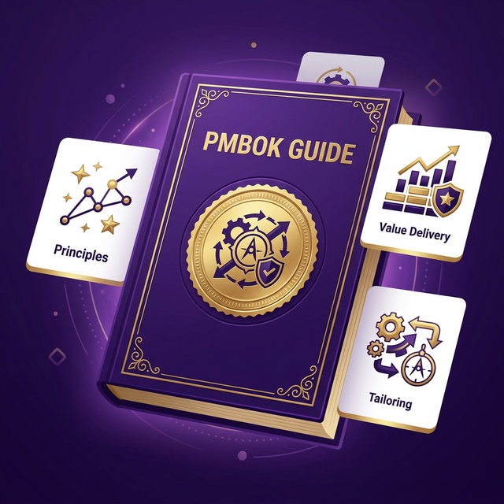
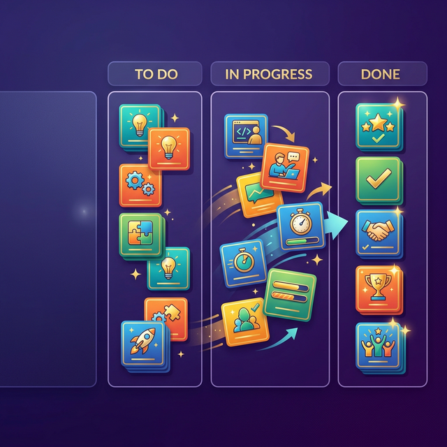
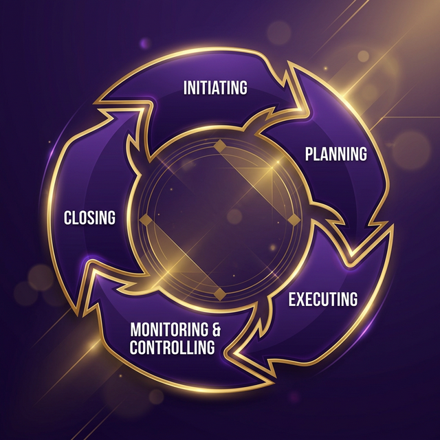
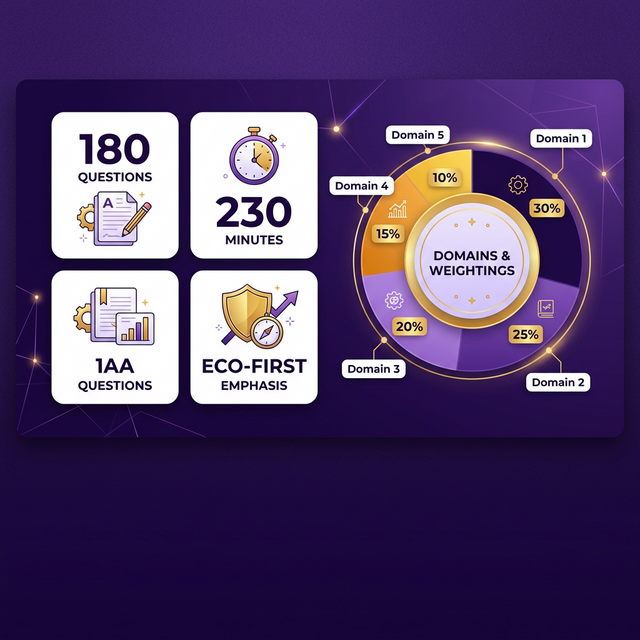

<!-- _class: cover -->

PMP exam preparation course

  PMP
  
  Mastery Framework

Day 2 session

<h1 class="cover-title">Day 2 - Your PMP® Exam Toolkit: Core Resources & the ECO Blueprint</h1>

<!--
"Welcome back to our PMP® Exam Preparation Course.”
"I hope you had a chance to reflect on your personal goals for PMP® certification after our session yesterday.”
"Today, we shift our focus to the essential resources that will form the backbone of your study and our course, and we'll delve into the most critical document for your exam preparation: the PMP® Exam Content Outline, or ECO.”
"Understanding these resources and the ECO thoroughly is a fundamental step towards success.
-->

---

<!-- _class: agenda -->

# Core Study Materials - Your Toolkit
- Today's focus is on becoming familiar with the essential resources for your PMP® exam preparation
- These materials will provide the foundational knowledge you need to succeed.

<!--
"As we embark on our PMP® preparation journey, it's vital to know the key resources we'll be using. Think of these as the essential tools in your project management toolkit for tackling the exam.”
"These resources provide the core knowledge and framework you need to understand the principles and practices tested in the PMP® exam.”
"We will spend time today introducing you to the PMBOK® Guide, which details a wide range of project management topics, and the Agile Practice Guide, which highlights the growing importance of agile methodologies in the profession and the exam.”
"We will also touch upon the Process Groups, which offer a high-level view of the project lifecycle.”
"However, the most crucial resource we'll introduce today is the PMP® Exam Content Outline, or ECO. Remember, this is the blueprint that dictates exactly what is covered in the exam."
-->

---

# The PMBOK® Guide (7th Edition)
- Begin to navigate its structure and familiarise yourself with its key sections and concepts.

<!--
"The Project Management Body of Knowledge, or PMBOK® Guide, is a foundational document in the field of project management and a key reference for the PMP® exam.”
"It encompasses a vast array of knowledge areas and provides a structured approach to managing projects.”
“While our course prioritises the ECO, the PMBOK® Guide offers crucial context and detailed explanations of many of the concepts you'll encounter. ”
“Your task is to start becoming comfortable navigating the PMBOK® Guide, understanding its structure, and identifying the broad range of topics it addresses. Don't feel you need to master it all immediately; we will guide you through the relevant sections as we progress.”
-->

---

# The Agile Practice Guide
- 
- Recognise the importance of agile methodologies in the current PMP® exam.
- Familiarity with agile principles, practices, and terminology is essential for exam success

<!--
"Next, we have the Agile Practice Guide.”
"The PMP® exam today significantly tests your knowledge of agile and hybrid approaches, and this guide is an essential resource for mastering those concepts.”
"Co-created by PMI and the Agile Alliance, the Agile Practice Guide provides the principles and practices needed to manage projects in environments that are not purely predictive.”
“Becoming familiar with its contents is crucial for exam success.”
-->

---

# Understanding Process Groups
- Understand these high-level phases as a framework for project management processes.

<!--
"Finally, let's briefly review the Project Management Process Groups.”
"These five groups – Initiating, Planning, Executing, Monitoring and Controlling, and Closing – represent the high-level phases of a project lifecycle."
"Think of them as a framework that helps categorise when different project management processes typically occur, regardless of the specific methodology being used.”
"While the ECO is the blueprint for what to study, the Process Groups provide context for when certain processes are performed.”
-->

---

# "About the PMP® Exam" &
- Course Description
- 
- Our primary focus is on the ECO, not just the PMBOK® Guide

<!--
"Hopefully, you've already had a chance to look at any introductory materials we've provided about the PMP® Exam itself.”
"These sections usually cover important details about the exam format, the number of questions, the duration, and the types of questions you can expect.”
"Crucially, I want to reiterate the point made in our course description: our primary focus is on the PMP® Exam Content Outline, or ECO.”
“While the PMBOK® Guide is a valuable resource, the ECO is the document that directly outlines what you will be tested on. Our course is structured to ensure we cover each domain, task, and enabler within the ECO in detail.”
“Crucially, I want to reiterate the point made in our course description: our primary focus is on the PMP® Exam Content Outline, or ECO”
-->

---

# The Critical PMP® Exam Content Outline (ECO)
- Download the official PMP® ECO from PMI.org. This is your essential blueprint for the exam.
- Begin to familiarise yourself with its structure:
- Domains: People, Process, Business Environment.
- Tasks within each Domain.
- Enablers that support each Task (examples of the work associated with the task).

<!--
"If you haven't already, your absolute priority today is to download the official PMP® Exam Content Outline from the PMI website (www.pmi.org). Consider this document your most important guide throughout your preparation."
"The ECO is structured into three key Domains: People, Process, and Business Environment.”
"Within each Domain, the ECO lists specific Tasks that a competent project manager should be able to perform."
"For each Task, it then provides Enablers, which are examples of the types of activities or work that help you accomplish that task."
"Understanding this hierarchical structure is key to navigating the exam content effectively."
-->

---

# Overview of the PMP® Exam Domains
- Understand the three key domains and their weighting in the exam:
- Process: 50% of the exam. Covers the technical aspects of managing a project.

<!--
"Let's take a closer look at the three domains.”
"The 'People' domain, carrying 42% of the exam weight, emphasises the crucial skills needed to lead and manage project teams and engage effectively with all stakeholders."
"The 'Process' domain, which constitutes the largest portion at 50%, focuses on the technical project management skills and knowledge required to plan, execute, monitor, and control the project.”
"Finally, the 'Business Environment' domain, at 8%, examines your understanding of how projects align with the overall business strategy, how to deliver value, and how to manage compliance and organisational change.”
"Keep these weightings in mind as you plan your study, as they indicate the relative emphasis on each area in the exam.”
-->

---

<!-- _class: tips -->

# Activity - Navigating the ECO
- Spend time navigating the downloaded PMP® ECO document.
- Try to understand how the Domains, Tasks, and Enablers are organised within the document.
- Make notes of any initial questions you have about the content or structure of the ECO.

<!--
"For our activity today, I want you to spend some dedicated time exploring the PMP® ECO document that you've downloaded.”
"Familiarise yourself with how the domains are presented, how the tasks are listed under each domain, and the types of enablers provided for each task."
"As you navigate the document, jot down any initial questions that come to mind. There's no such thing as a silly question at this stage!”
"Also, start thinking about how the information in the PMBOK® Guide and the Agile Practice Guide might connect with the different Domains and specific Tasks you see in the ECO.”
-->

---

