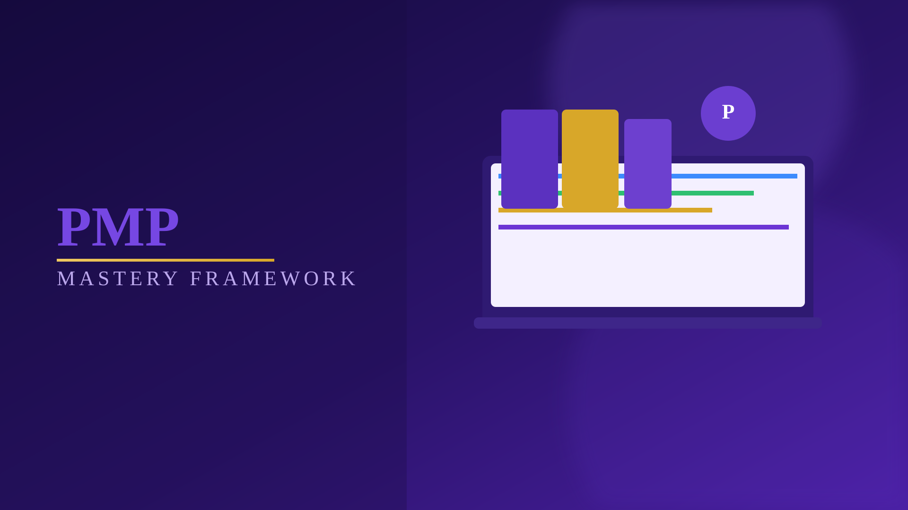
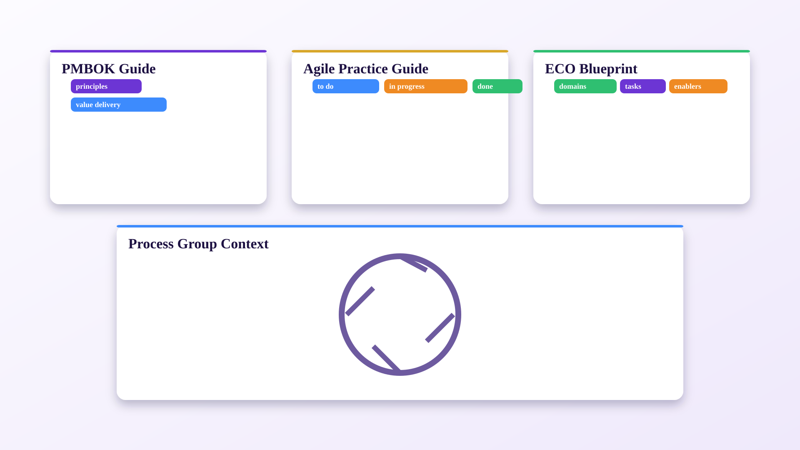
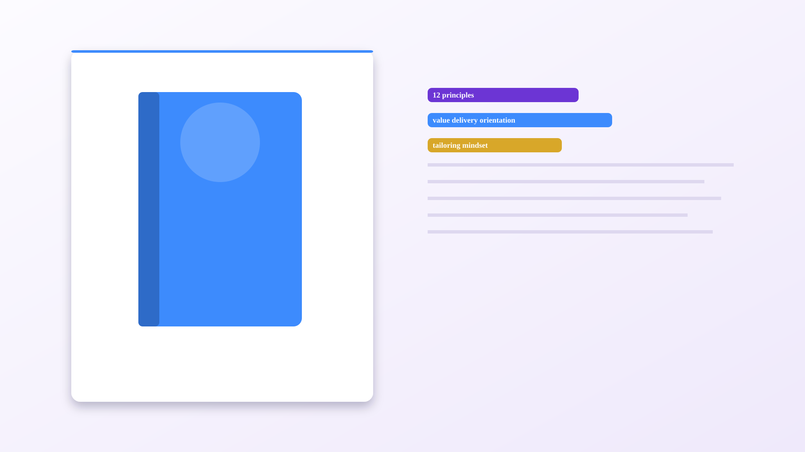
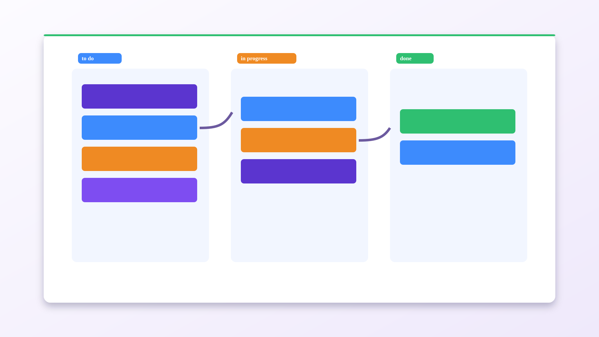
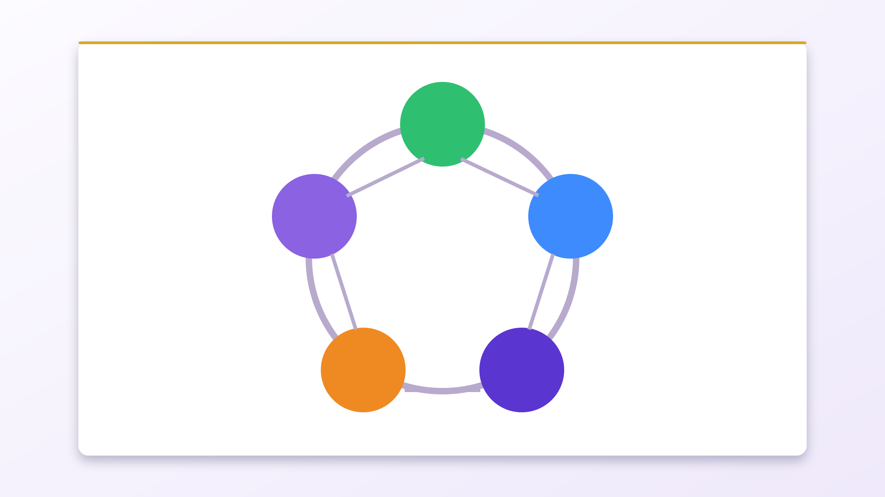
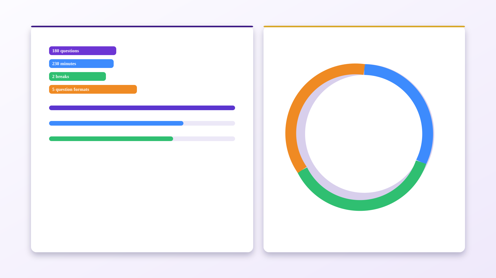
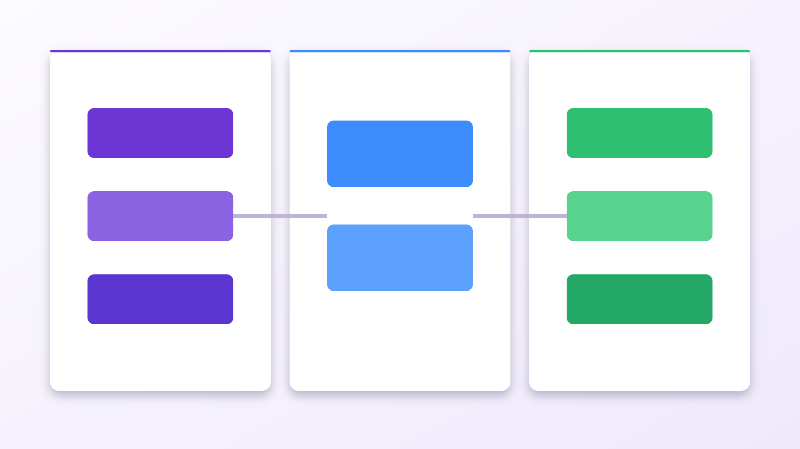
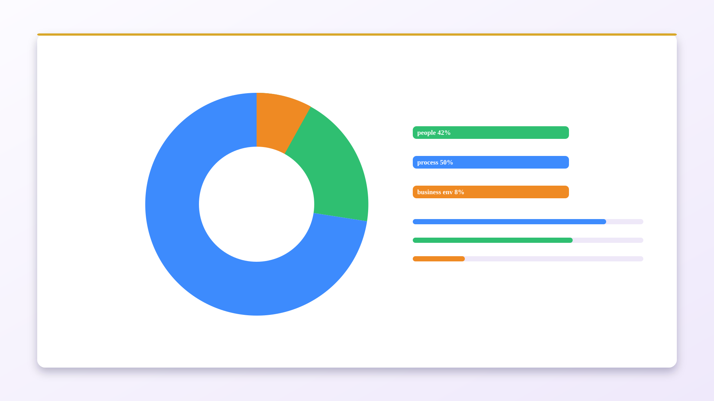
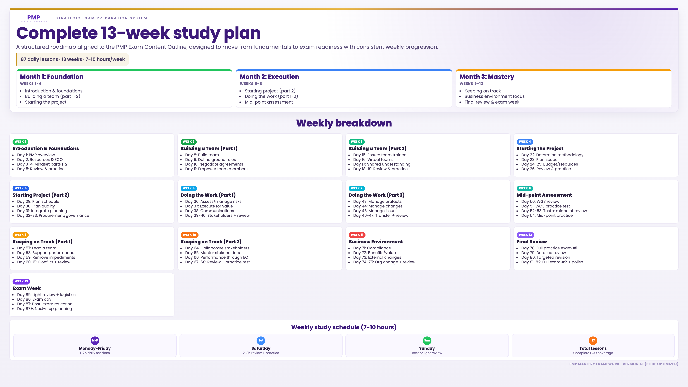

<!-- _class: cover -->

PMP exam preparation course

  PMP
  
  Mastery Framework

Day 2 session

<h1 class="cover-title">Your toolkit: Resources & ECO Blueprint</h1>

---

<!-- _class: agenda -->

# Day 2 objectives
## Build the right study foundation

- Understand the resources you will use throughout the program.
- Clarify the role of PMBOK Guide vs Agile Practice Guide.
- Use Process Groups as lifecycle context (not exam blueprint).
- Anchor your study on the **PMP Exam Content Outline (ECO)**.
- Navigate domains, tasks, and enablers with confidence.

---

# Core study materials: your toolkit

- **PMBOK Guide (7th Edition)** for principles and context.
- **Agile Practice Guide** for agile/hybrid expectations.
- **Process Groups** for temporal project flow context.
- **ECO** for what is explicitly tested in the exam.

**Rule:** ECO defines scope; guides provide depth.

---

# PMBOK Guide (7th Edition)

- Foundational reference for recognized project management practices.
- Expands concepts behind tasks found in exam scenarios.
- Use it to strengthen conceptual understanding.

**Use strategically:** Do not memorize everything; map it back to ECO tasks.

---

# Agile Practice Guide

- Essential for agile and hybrid exam scenarios.
- Reinforces adaptive planning, collaboration, and incremental value.
- Provides vocabulary and patterns frequently used in questions.

**Exam reality:** Predictive-only preparation is insufficient.

---

# Understanding process groups

- Initiating
- Planning
- Executing
- Monitoring & Controlling
- Closing

Process Groups help you place activities in lifecycle time, while ECO tells you what PMI assesses.

---

# About the PMP exam + course focus

- Exam format: 180 questions in 230 minutes.
- Two optional 10-minute breaks.
- Question types: MCQ, multiple response, matching, hotspot, fill-in-the-blank.

**Course focus remains ECO-first**: domains -> tasks -> enablers.

---

# The critical PMP exam content outline (ECO)

- Download the official ECO from PMI.org.
- Learn its hierarchy:
  - Domains
  - Tasks
  - Enablers

Treat ECO as your authoritative blueprint for exam alignment.

---

# Domain weighting overview

- **People**: 42%
- **Process**: 50%
- **Business Environment**: 8%

Translate weighting into study time and question-practice priorities.

---

<!-- _class: tips -->

# Activity: navigating the ECO
## Guided exploration task

- Open ECO and locate all three domains.
- Trace one task and its enablers end-to-end.
- Note where PMBOK and Agile references support that task.
- Write down your top 3 questions for Day 3.

---

<!-- _class: calendar-snap -->

# 13-week plan snapshot

- Day 2 positions your **resource system** for the whole roadmap.
- Build your study rhythm around weekly sequence and review checkpoints.
- Keep ECO visible while reading PMBOK/Agile references.
- Prepare for Day 3 mindset deep dive (People domain emphasis).

---

<!-- _class: tips -->
# Day 2 action checklist
## Complete before Day 3

- Download and save the official ECO locally.
- Bookmark PMBOK and Agile sections for quick access.
- Capture your ECO navigation notes and questions.
- Confirm your weekly study schedule (7-10 hours target).
- Identify one weak domain for extra attention this week.

---

# Q&A + next session

- Resolve ECO structure questions now.
- Clarify study sequencing and resource usage.

### Tomorrow (Day 3)
- PMP mindset principles review (part 1)
- Proactive, value-driven, stakeholder-focused thinking
- Exam decision logic: assess -> meet -> action -> track
